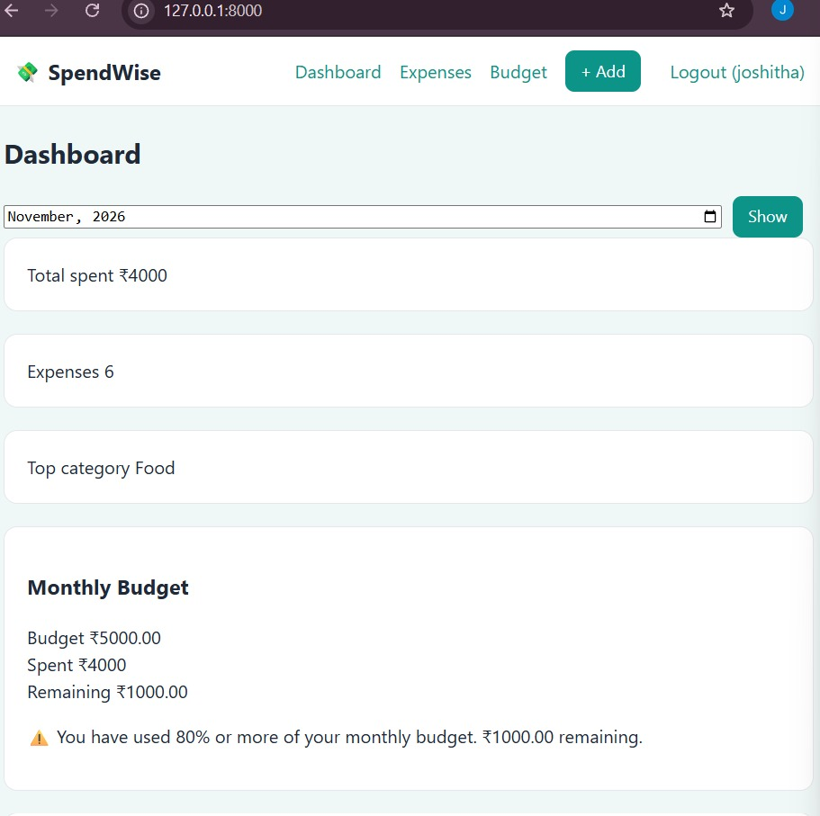
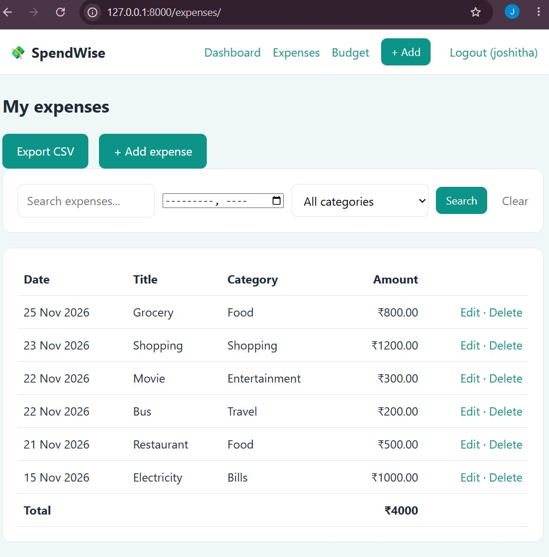
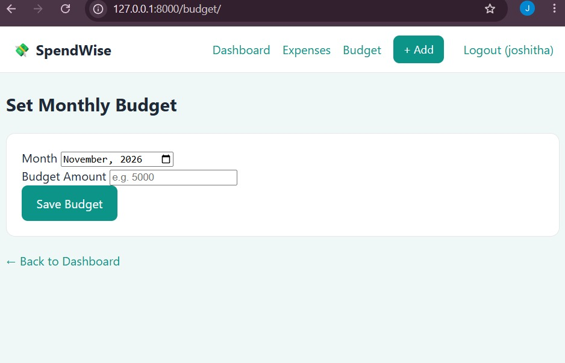

# SpendWise - Personal Expense Tracker (Django)

# SpendWise – Personal Expense Tracker

SpendWise is a beginner-friendly Django web application that helps users manage their personal expenses, monitor monthly spending, set a monthly budget, search expenses, and export expense data as a CSV file.

## 📸 Screenshots

### Dashboard


### Expenses


### Budget & Spending Chart


## Features

- User registration and login
- Add, edit, and delete expenses
- Expense categories
- Month-based expense filtering
- Search expenses by title
- Monthly spending dashboard
- Spending summary by category
- Category-wise chart using Chart.js
- Monthly budget tracking
- Budget warning when 80% or more of the budget is used
- Over-budget notification
- Export expenses to CSV
- User-specific expense data
- Django admin support

## Technologies Used

- Python
- Django
- SQLite
- HTML
- CSS
- JavaScript
- Chart.js

## Project Structure

| File / Folder | Purpose |
|---|---|
| `manage.py` | Django command-line entry point |
| `spendwise/settings.py` | Project configuration, database, templates, static files, and authentication settings |
| `spendwise/urls.py` | Main URL configuration |
| `tracker/models.py` | Database models such as Category, Expense, and MonthlyBudget |
| `tracker/forms.py` | Django forms and validation |
| `tracker/views.py` | Application logic for registration, dashboard, expenses, budget, search, and CSV export |
| `tracker/urls.py` | URL-to-view mapping |
| `tracker/admin.py` | Django admin configuration |
| `tracker/management/commands/` | Custom management commands such as category seeding |
| `templates/` | HTML templates used by the application |
| `static/` | CSS and JavaScript files |

## How to Run the Project

### 1. Clone the repository

```bash
git clone https://github.com/JoshithaM-19/SpendWise.git
cd spendwise
```

### 2. Create a virtual environment

```bash
python -m venv venv
```

### 3. Activate the virtual environment

**Windows:**

```bash
venv\Scripts\activate
```

**Mac/Linux:**

```bash
source venv/bin/activate
```

### 4. Install dependencies

```bash
pip install -r requirements.txt
```

### 5. Create and apply migrations

```bash
python manage.py makemigrations
python manage.py migrate
```

### 6. Add default categories

```bash
python manage.py seed_categories
```

### 7. Create an admin user (optional)

```bash
python manage.py createsuperuser
```

### 8. Start the development server

```bash
python manage.py runserver
```

Open:

```text
http://127.0.0.1:8000/
```

Then register a new account and start adding expenses.

## How the Application Works

SpendWise follows Django's MVT architecture:

```text
Browser
   ↓
URL
   ↓
View
   ↓
Model / Database
   ↓
View
   ↓
Template
   ↓
HTML Response
```

For example, when a user adds an expense:

1. The user submits the expense form.
2. Django receives the request through the URL configuration.
3. The view validates the form.
4. The expense is saved to the database.
5. The expense is associated with the logged-in user.
6. Django redirects the user back to the expense list.

## Security and User Data

Each user's expenses are kept separate.

The application uses the logged-in user when querying expenses:

```python
Expense.objects.filter(user=request.user)
```

Edit and delete operations also verify that the expense belongs to the current user.

The application uses Django's built-in authentication system, password hashing, sessions, and CSRF protection.

## Budget Feature

Users can set a monthly spending budget.

The dashboard compares:

```text
Monthly Budget
      ↓
Amount Spent
      ↓
Remaining Amount
```

A warning is displayed when the user has used 80% or more of the budget, and an over-budget message is displayed when spending exceeds the budget.

## Search Feature

Users can search expenses by title.

For example:

```text
Search: restaurant
```

The application uses Django's `icontains` lookup to perform a case-insensitive title search.

## CSV Export

Users can export their expenses as a CSV file.

The exported file contains:

- Date
- Title
- Category
- Amount
- Note

## Database

The project uses SQLite during development.

The main models are:

- `Category`
- `Expense`
- `MonthlyBudget`

An `Expense` is connected to both the logged-in user and an expense category using Django `ForeignKey` relationships.

## Why DecimalField is Used for Money

Expense amounts and budgets use Django's `DecimalField` instead of floating-point numbers.

This helps avoid common floating-point rounding problems when working with monetary values.

## Future Improvements

Possible future improvements include:

- Category-wise budget limits
- Expense pagination
- REST API using Django REST Framework
- Data visualizations with additional charts
- Automated tests
- Deployment to a cloud platform
- Improved mobile responsiveness

## Author

**Joshitha M**

Aspiring Python Full Stack Developer